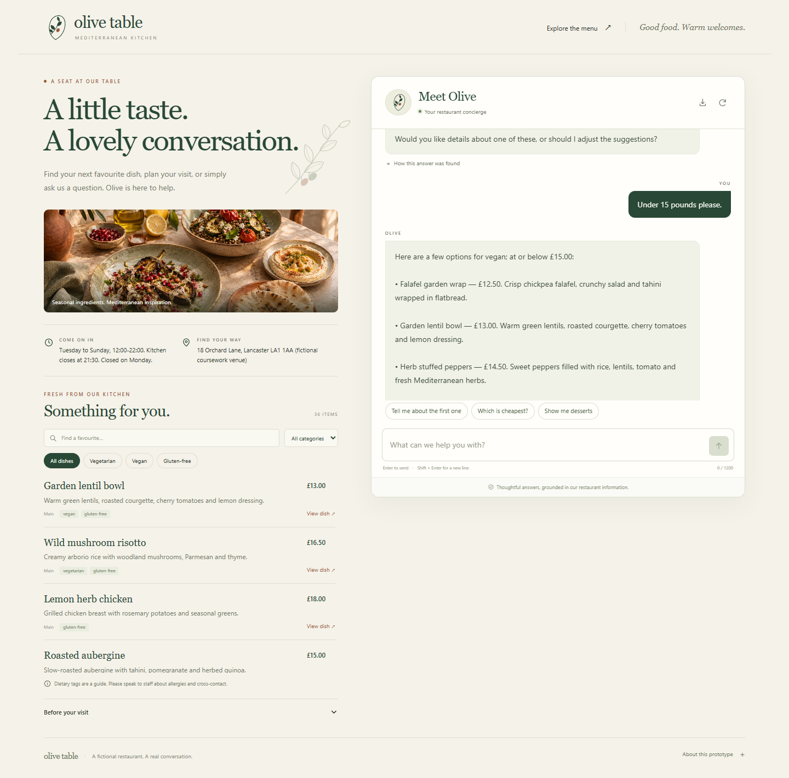

# Olive Table restaurant concierge

A runnable CNSCC324 task 1 prototype: a locally trained supervised Python NLP model, a contextual dialogue engine and an interactive restaurant website. The menu has 36 items across five categories. The venue, menu, prices and contact details are fictional demonstration data. English is the supported conversation language.



The frozen 72-question authored evaluation records **81.94%** complete-system intent accuracy versus **61.11%** for the baseline. All 15 functional/API tests pass. These are measurements on a small synthetic English sample, not a real-customer benchmark; full results and failure cases are included in `evaluation/results/`.

## Start on Windows

1. Install Python 3.11 or newer if it is not already installed.
2. Extract the entire project ZIP to a normal writable folder.
3. Double-click `START_WINDOWS.bat`. It validates a working Python interpreter, creates a project-local environment and installs the dependencies on first use. First-time installation requires internet access; subsequent starts reuse the environment.
4. The browser opens **http://127.0.0.1:8765** when the application is ready. Keep the server window running. Press Ctrl+C in that window to stop it.

The launcher checks the actual interpreter, so an installed `py` command with a stale registered Python path does not prevent it using a working `python` command. If no valid Python 3.11+ is found, install it from https://www.python.org/downloads/ and add it to PATH. If Olive Table is already running, the launcher reopens its page; it does not stop other programs using the port.

For a setup check without opening a browser or starting a server, run `START_WINDOWS.bat --check` in the project folder. To start without opening a browser, use `START_WINDOWS.bat --no-browser`. To choose another port, use `START_WINDOWS.bat --port 8770`. Installation downloads are cached inside the ignored project environment.

## Manual start on Windows

```powershell
python -m venv .venv
.\.venv\Scripts\python.exe -m pip install -r requirements.txt -c constraints-model.txt
.\.venv\Scripts\python.exe launch.py
```

On macOS or Linux:

```sh
python3 -m venv .venv
.venv/bin/python -m pip install -r requirements.txt -c constraints-model.txt
.venv/bin/python launch.py
```

After installation the complete application runs locally without an API key, paid model, external fonts, CDN or network connection. The Flask development server is appropriate for this local demonstration.

## Try a conversation

Start with `What time do you open?`, then start a fresh conversation:

1. `Can you recommend a vegetarian main?`
2. `Make it vegan instead.`
3. `Under 15 pounds please.`
4. `Which is the cheapest?`

Explore the menu filters, inspect the evidence under a reply, compare the baseline method, export a transcript and reset the conversation. A booking enquiry explains how to contact the restaurant; the prototype does not create real reservations.

## Command line

```sh
python cli.py
```

Use the Python executable from the environment you created. See `python cli.py --help` for supported options.

## Tests and evaluation

The package includes the fitted intent model. To reproduce training and the development-only comparison of Logistic Regression, Multinomial Naive Bayes and Linear SVM:

```sh
python training/train.py
```

Training uses 380 authored utterance families over 19 labels, with a fixed grouped split before augmentation. Read `training/README.md` for exact split counts, selection rules, versions and the limitations of synthetic data. The final evaluation queries are never read by the training script. Retraining overwrites the model; restart the server afterwards and rerun evaluation so the report matches the new artifact.

```sh
python -m unittest discover -s tests -v
python evaluation/run_evaluation.py
```

The evaluation writes machine-readable results and an explanation under `evaluation/results/`. Read `evaluation/README.md` before interpreting the figures. The examples are authored English questions, not a representative sample of restaurant customers. Similarity values are retrieval scores, not calibrated probabilities that an answer is correct. Timing measurements depend on hardware and exclude browser/network time.

## Project contents

- `app.py`: Flask routes, input validation and isolated, temporary sessions.
- `launch.py`: readiness checks, browser opening, setup diagnostics and port handling.
- `restaurant_bot/`: retrieval, language processing and dialogue state.
- `training/`: supervised training source, authored corpus and grouped split manifest.
- `models/`: the actual fitted model and measured development comparison.
- `data/`: editable fictional restaurant information and FAQ examples.
- `templates/` and `static/`: accessible responsive chat and menu interface.
- `cli.py`: text-only interface to the same NLP engine.
- `tests/`: functional regression checks.
- `evaluation/`: authored evaluation corpus, runner and measured results.
- `docs/`: English team report source and Chinese project guide, presentation plan.
- `readme.txt`: required external software library inventory.

## Coursework preparation

Read `docs/PROJECT_GUIDE_ZH.md` to understand the methods and demonstration. The team report has clearly marked fields for the lab class, team number, member names and actual responsibilities. Complete these with your group's information and review the implementation before submission. Each member's one-page individual report must describe their actual work. The supplied project can be studied, adapted and extended, and its reported evaluation should be rerun after any functional or data changes.

The brief sets a maximum of four pages for the team report, submission by the end of Week 10 and a 20-minute English presentation with PPT in Week 11 involving at least three speakers. Check Moodle for the actual dates and any later instructions. Source code and the team report are submitted by the team leader; individual reports are submitted by each member.

## Limitations

This is a small English supervised intent, lexical retrieval and dialogue prototype. It uses authored restaurant knowledge and bounded context. Unfamiliar paraphrases, ambiguous language and complex negation can fail. Ingredient tags do not establish allergy safety or prevent kitchen cross-contact. Restaurant facts are editable examples. Server sessions are temporary and do not survive a restart. Browser conversation history is kept in this browser tab until reset or closed. The application does not log raw customer conversations or store personal booking information.

## References

- Coursework brief: Scott Piao, CNSCC324 Natural Language Processing Coursework for Assessment, Autumn 2026, sections 2.1 to 3.
- Flask documentation: https://flask.palletsprojects.com/en/stable/quickstart/ and https://flask.palletsprojects.com/en/stable/testing/
- scikit-learn text feature extraction: https://scikit-learn.org/stable/modules/feature_extraction.html#text-feature-extraction
- scikit-learn TF-IDF: https://scikit-learn.org/stable/modules/generated/sklearn.feature_extraction.text.TfidfVectorizer.html
- scikit-learn F1 score: https://scikit-learn.org/stable/modules/generated/sklearn.metrics.f1_score.html

The project contains no copied restaurant dataset, private credentials or pretrained model weights. Python dependencies retain their own licenses.
